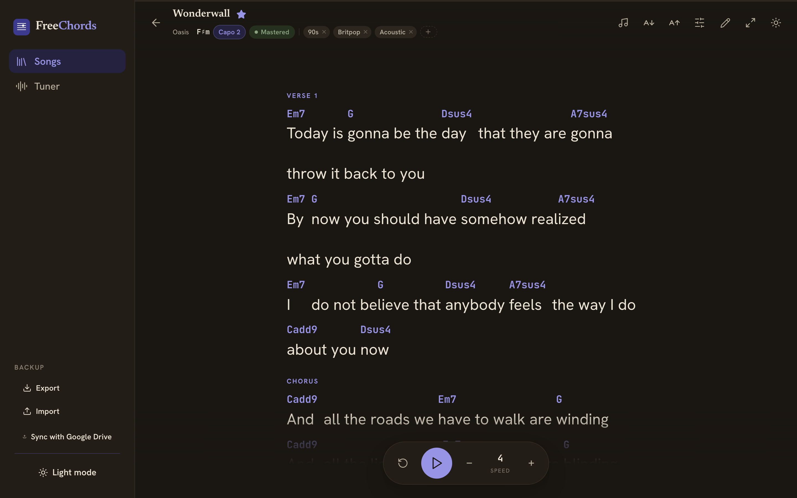
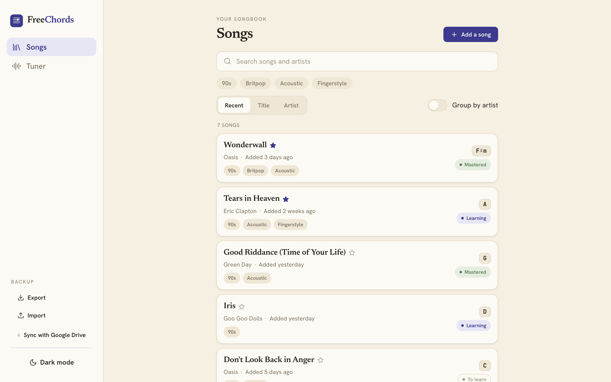
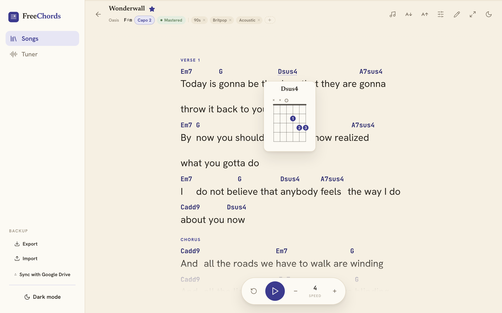
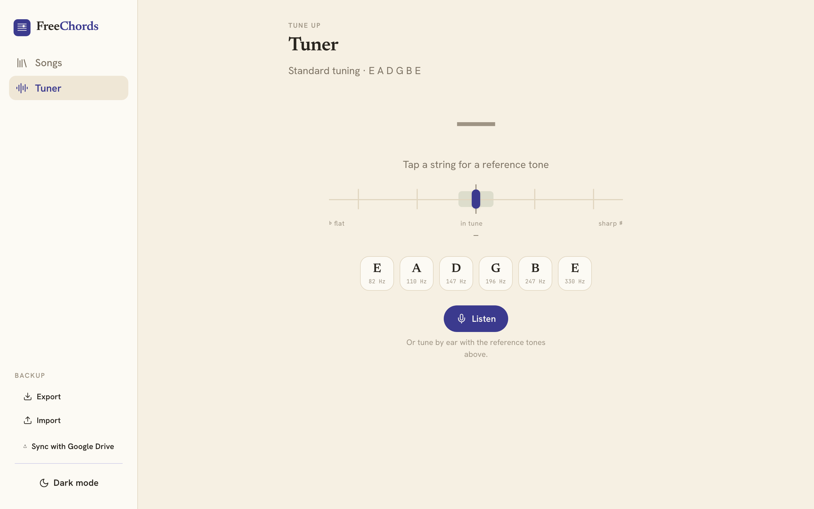
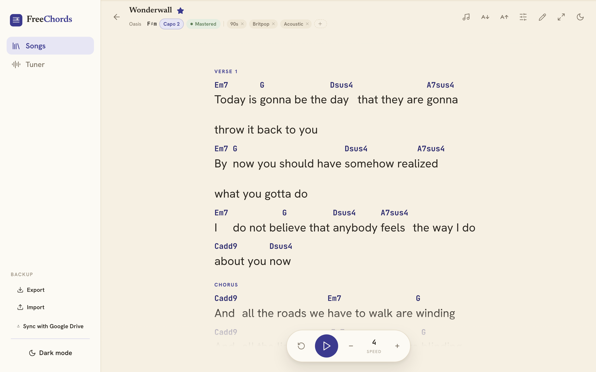
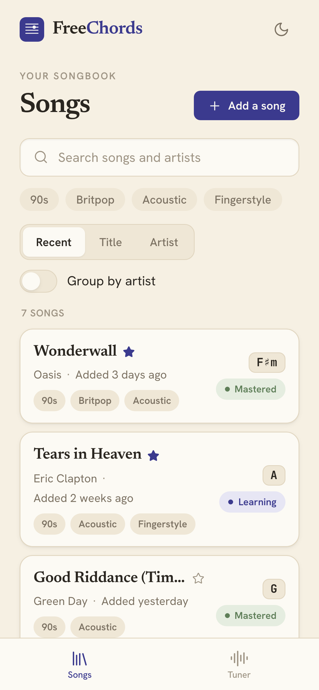

# FreeChords

A calm, ad-free personal guitar chord app — chords sitting directly above the
lyric syllables they belong to, the deliberate opposite of cluttered,
upsell-heavy tab sites. Built for playing acoustic, chord-based songs from a
laptop or a tablet on a music stand — plus tools to practice, tune, train your
ear, and record yourself. A built-in **Guide** (opens on first launch) walks
through it all.

**No ads, no clutter, no upsells, anywhere, ever.**

**▶ Live: <https://freechords.app>** — works in any browser on
phone, tablet, or desktop, and keeps working **offline** after the first load.

## Screenshots

<p align="center">
  
</p>

<table>
  <tr>
    <td width="50%"></td>
    <td width="50%"></td>
  </tr>
  <tr>
    <td width="50%"></td>
    <td width="50%"></td>
  </tr>
</table>

<p align="center">
  
</p>

## Features

### Songbook

- **Library.** Searchable, sortable (Recent / Title / Artist), group-by-artist,
  and tag-filterable. Each song shows its key, when it was added, a favorite
  **★**, and a learning status (**To learn → Learning → Mastered**) you can
  cycle inline. Click an artist to see all their songs; starred songs float to
  the top.
- **Three ways to add a song.**
  - **Paste** raw chords copied from a webpage — they're auto-aligned into
    chords-over-lyrics (ChordPro), with a live preview and detected-chord chips.
    Handles PDF/OCR-flattened pastes (where the columns are lost) gracefully.
  - **Upload a screenshot** — **Claude vision** reads the chart into ChordPro
    with the chords over the right words. Uses your own API key (browser-direct,
    no backend), or an optional **shared reader** the owner can enable so it
    works with no key at all (see **Shared image import** below); falls back to
    on-device **OCR** otherwise.
  - **Grid editor** — type or paste lyrics, then click above any word to drop a
    chord from a type-to-filter picker; drag a chord to nudge it, place chords on
    lyric-less lines (intros/turnarounds), and bulk-paste a whole verse. Round-
    trips to the same ChordPro, so any existing song opens in it.
- **Edit / delete** any song (fields + ChordPro source, or the Grid editor),
  with a live preview.

### Play-along (song view)

- **Teleprompter auto-scroll** with edge fade, a simple **Speed** control or a
  **BPM** tempo with **tap-tempo** (or the space bar). The screen stays awake
  while scrolling.
- **Transpose** (±semitones) and **capo**; **hide chords**; adjustable font
  size; **full-screen focus mode** (press **Esc** to leave).
- **Chord diagrams** — hover or tap any chord for its fretboard fingering.
- **Key ping** (hear the tonic before you play) and a **metronome**.
- **Record a scratch take** — a 3·2·1 count-in, then it captures your mic while
  the sheet scrolls; save or share the audio file (its name includes the key and
  capo). Optional **tuning check** listens while you play and flags if the
  guitar drifts out of tune.
- **Export a song** as a self-contained offline HTML player (auto-scrolls) or a
  printable **PDF**. Each song remembers its own transpose, font, hide-chords,
  and speed.

### Playlists

Build a set and play straight through — **auto-advance** between songs, a
between-song countdown that previews the **next song's key and capo**, and a
**cross-fade**. Album playlists, reordering, and offline/PDF export of a whole
set.

### Practice — A/B loops

Paste a **YouTube** link or load an **audio file**, set an **A–B loop** over a
tricky passage, and slow it **0.25–2×** without changing pitch. Draggable A/B
pins on an integrated timeline, saved loops (Drive-synced), shareable links, and
a pre-roll lead-in.

### Training — ear trainer

Hear two notes and **name the interval**. Choose the interval pool, direction
(up / down / both / harmonic) and speed; **adaptive weighting** drills the
intervals you miss more often and tracks **per-interval accuracy** over time.
Keyboard shortcuts throughout.

### Notation

Write sheet music in the browser — a single treble staff in 4/4. Place notes by
**clicking the staff** or playing the **on-screen piano** (or the computer
keyboard); pick a **duration** (whole → 16th), add **dots**, **rests**, and
**accidentals**; **select** a note to re-pitch or delete it. **Play it back**
with a tempo and a moving playhead, **undo/redo**, and **export a PNG** or print.
Scores save on your device. Rendering is [VexFlow](https://vexflow.com)
(lazy-loaded so it never weighs down the rest of the app); playback is Web Audio.

### Tuner

Reference tones for each string plus a microphone **Listen** mode with live
pitch detection that locks onto each string, an in-tune meter, guitar/bass and
chromatic modes, and an adjustable **in-tune window** (Strict / Standard /
Relaxed).

### Throughout

- **Guide.** A built-in intro/feature tour that opens on first launch and is
  reachable from the nav any time.
- **Feedback.** A one-tap **Feedback** button (bottom-right on mobile, in the
  sidebar on desktop, and in the Guide) that auto-attaches which screen you're on
  and sends bugs, ideas, and requests straight to a Google Sheet you own —
  optional, self-owned, no backend, and it queues offline. See **Feedback** below.
- **Responsive** — sidebar on desktop, bottom tab bar on mobile — with a warm
  light and low-light dark mode.
- **Offline-capable** — runs **fully offline** after the first load (the app
  shell and fonts are self-hosted and cached by a service worker). It runs in
  the browser; a home-screen shortcut opens the browser too, so there's no
  separate installed-app copy to fall out of sync.
- **On-device by default.** Everything is stored in your own browser; nothing is
  uploaded or shared unless you choose to sync or share.
- **Backup & sync.** Export/import your songbook as a file, or connect your own
  **Google Drive** for optional, offline-first cross-device sync (a private app
  folder, no server — see **Cross-device sync** below).

## Tech

[Vite](https://vite.dev) + [React](https://react.dev). Songs are stored as
**ChordPro** and parsed/transposed with
[ChordSheetJS](https://github.com/martijnversluis/ChordSheetJS). Icons from
[lucide-react](https://lucide.dev); chord-fingering diagrams from the open
[chords-db](https://github.com/tombatossals/chords-db) database; fonts
self-hosted via [Fontsource](https://fontsource.org); offline support via
[vite-plugin-pwa](https://vite-pwa-org.netlify.app). The visual design (tokens,
components, screens) comes from the FreeChords design system authored in Claude
Design.

## Getting started

```bash
npm install
npm run dev      # start the dev server at http://localhost:5173
```

Other scripts:

```bash
npm run build    # production build into dist/
npm run preview  # preview the production build
```

## Project structure

```
src/
  components/   design-system primitives (Button, Card, Tag, SideNav, …) + Icon
  screens/      Library, SongView, SongEdit, AddImport, GridEditor, Playlists,
                Practice (A/B loops), Training (ear trainer), Notation, TunerView,
                Settings, Guide, TuningLab (experimental)
  lib/          music, chordpro (ChordSheetJS), gridedit (grid ⇄ ChordPro),
                chords (chords-db), tuning (chord/tuning DSP), loop, imageImport
                (Claude vision / OCR), score + scoreRender (VexFlow) + scorePlayback
                + scoreExport, songbookExport, feedback, storage, backup, sync
  data/         sample songbook
  styles/       design tokens + app stylesheet
public/         brand SVGs (mark + wordmark)
worker/         optional Cloudflare Worker: shared image-import proxy (holds the key)
```

## Status & roadmap

This is a personal app and a work in progress. The app ships with **one sample
song** so the layout is clear on first run; everything else — the songs you add,
favorites, learning status, tags, per-song playback prefs, and theme — is stored
**only in your own browser** (`localStorage`). Nothing you add is uploaded or
shared, and every visitor to a hosted copy gets their own private songbook.
For cross-device use there's **optional** Google Drive sync (see below); it's
off until you set it up, and the app stays fully usable and offline without it.

For **offline use on a phone or tablet**, serve it over HTTPS (offline caching
is allowed on `https://…` or `localhost`). Any free static host — Netlify,
Vercel, GitHub Pages — works; build with `npm run build` and deploy the `dist/`
folder. A home-screen shortcut opens it in the browser (so it shares the same
storage and Drive sync — no separate installed-app silo).

## Feedback (optional)

The in-app **Feedback** button lets testers send bugs, ideas, and requests in one
tap, with the current screen (and song) auto-attached. Submissions post to a
Google Sheet **you** own via a tiny Google Apps Script — no third-party service,
no backend, and notes queue on-device if they're offline. It's hidden-cost-free
and stays out of the way until you wire it up: set `VITE_FEEDBACK_URL` to your
Apps Script `/exec` URL (locally in `.env`, or as a GitHub **Actions variable**
for deploys). Full walkthrough — including the ~15-line script — in
[`docs/feedback-setup.md`](docs/feedback-setup.md).

## Shared image import (optional)

By default, screenshot import uses each person's own Claude key (or on-device OCR
with none). If you'd rather let a group of testers import screenshots **without**
each bringing a key, you can run a shared reader: a tiny **Cloudflare Worker**
(in [`worker/`](worker)) holds *your* key server-side so it never ships to the
browser, and rate-limits it. Spend is **hard-capped Anthropic-side** — $10 of
prepaid credits with auto-reload off, plus a dedicated workspace spend limit — so
the app can't run up a surprise bill; when the pool's spent, import falls back to
OCR / bring-your-own-key. Enable it by setting `VITE_IMAGE_PROXY_URL` to the
Worker URL. Full setup — money cap, Worker deploy, and operation — in
[`docs/shared-key-setup.md`](docs/shared-key-setup.md).

## Cross-device sync (optional)

Sync keeps your songbook the same on your phone and laptop. It's **offline-first**
(your browser stays the working copy; Drive is just where it backs up and
reconciles) and **private** — your songs are saved to a hidden per-app folder in
*your own* Google Drive. The app never sees other people's data, and no server is
involved.

It's hidden until a Google OAuth **client ID** is provided at build time via the
`VITE_GOOGLE_CLIENT_ID` environment variable. To set it up:

### 1. Create the OAuth client ID

1. Go to the [Google Cloud Console](https://console.cloud.google.com/) and
   create a project (any name, e.g. "FreeChords").
2. **APIs & Services → Library →** search **Google Drive API** → **Enable**.
3. **APIs & Services → OAuth consent screen:** choose **External**, fill in the
   app name and your email. Add the scope
   `https://www.googleapis.com/auth/drive.appdata`. Add yourself (and anyone
   else who'll use it) as a **Test user**. You can leave it in **Testing** mode —
   no Google verification needed for personal use.
4. **APIs & Services → Credentials → Create Credentials → OAuth client ID →
   Web application.** Under **Authorized JavaScript origins** add the origins
   you'll run from:
   - `http://localhost:5173` (local dev)
   - your hosted origin, e.g. `https://freechords.app`
   (origins are scheme + host only — no path). Create it and copy the **Client ID**
   (looks like `1234-abcd.apps.googleusercontent.com`).

### 2. Use it locally

```bash
cp .env.example .env
# then edit .env and set VITE_GOOGLE_CLIENT_ID=<your client id>
npm run dev
```

The **Backup** controls (Export, Import, and **Sync with Google Drive**) live in
the sidebar footer on desktop, and at the bottom of the Songs page on mobile.

### 3. Use it on the deployed site

The build reads `VITE_GOOGLE_CLIENT_ID` from a repo **variable**. In the GitHub
repo: **Settings → Secrets and variables → Actions → Variables → New repository
variable**, name `VITE_GOOGLE_CLIENT_ID`, value = your client ID. The next deploy
will include sync. (The client ID is a public browser identifier, not a secret.)

> **Note:** in Testing mode you may be asked to re-authorize periodically — that's
> Google's behavior for unverified apps and is fine for personal use. Local data
> and offline use are never affected.

Contributions are welcome — see the license below.

## License

[MIT](./LICENSE).
